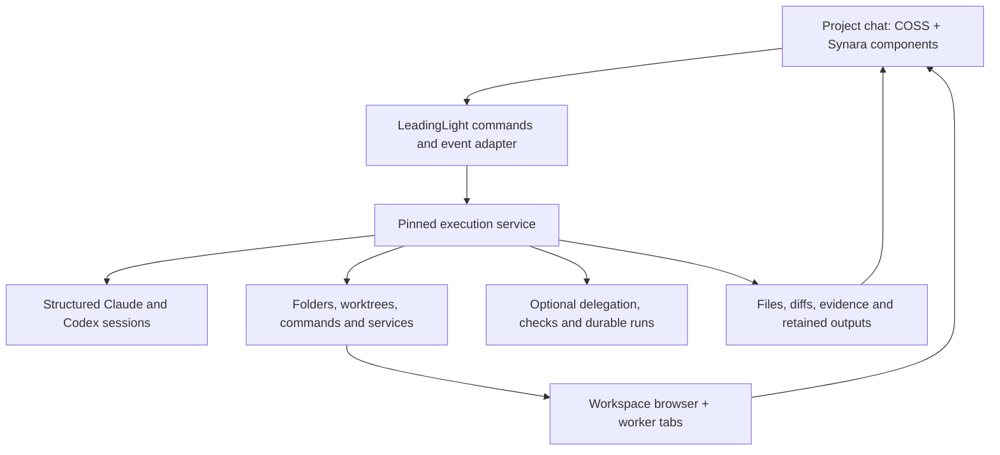

# Project 1: external projects and capable project chat

October 24, 2026. Implementation plan; no application code has been changed.

This is the delivery plan following the [source study][study]. It takes precedence over that study's provisional build order. Project 2 will add full LeadingLight knowledge traversal, task/report pages, and work commissioned while reading.

## Outcome and constraints

Link a local folder or a GitHub repository. In its project chat, Claude Code or Codex can inspect and change files, run commands, use project previews and public websites, produce outputs, and enlist other agents. Include model/effort controls, file attachments, and supported skills/MCP tools through the chosen provider. Work, questions, results and recovery remain understandable after the UI reconnects.

There is no mandatory plan → worker → reviewer process. Agents choose how to achieve the request: work alone, delegate, ask another model, run checks or repair an attempt. Coordination primitives and optional run templates support those choices. Success means the requested result exists and has appropriate evidence; a finished model turn alone is not evidence. User questions and provider permissions remain available without introducing a plan-approval ceremony.

The first real acceptance project is LeadingLight itself, in an isolated worktree. Use a small concrete feature: add “Copy page link” to a page's menu, using its existing stable `ll:` identity. Ask the project agent to implement it, exercise the menu in the connected browser, enlist an independent reviewer, and report the changed files and evidence. Confirm the feature is still absent before selecting it. Also exercise a plain folder: read two local documents and a CSV, produce a sourced summary and checked totals, and preview its output. The review step exercises delegation; it is not imposed on every future request.

Public-web research and local previews are in scope. Importing personal browser sessions, remote machines, a general scheduler, GitHub issue/PR management UI and Project 2's document experience are later work. Existing note chats keep their current behavior.

## Architecture we will implement

**Selected baseline:** a pinned Shipyard execution service behind a small LeadingLight client, using its structured Claude/Codex drivers. Reuse its working environment and run machinery together. Give the client a capability-aware session contract informed by Paseo and Synara. Use Synara's web interaction components over that contract, rather than mounting Shipyard's conversation UI.

This is a selection for the first integration proof, not a claim that Shipyard's provider handling is already reliable enough. Both providers must pass the interaction and reconnect gates below before the choice is locked. If the failure needs a broad rewrite, evaluate Paseo's packaged daemon/client as the single session owner, with Shipyard supplying environment/browser services. That fallback requires an explicit run-to-provider bridge; it must replace the chosen session owner, not duplicate it. Record that decision before building dependent UI. Do not run an open-ended three-backend experiment.

The host owns processes, pending provider requests, turns and execution history. LeadingLight owns the project-page binding and the user's retained outputs. Chat is a client. Keep stable project, workspace, conversation, worker, turn, request and artifact IDs; keep native provider handles opaque. A model/provider switch must not pretend two native sessions are the same conversation. Preserve optional provider-specific capabilities rather than flattening them away.

New application code should concentrate in `apps/desktop/src/lib/project-runtime/` and `apps/desktop/src/components/project-chat/`, with a small Tauri launcher/health adapter and a project-binding migration. These are proposed paths. Execution records live with the host; do not create a second scheduler or duplicate its mutable state in page properties. Project 2 will use these commands and records directly.

## What we reuse, and what we build

Pinned source baseline: Shipyard `12d35552d515`, Paseo `a54cc6dd11f7`, Synara `29b11e105200`. These are the inspected commits, not a claim about current stable releases. The exact packages/binaries we ship must be matched to source and checked in the first spike.

| Area | Copy or consume | LeadingLight-specific work |
|---|---|---|
| Process/session host | Shipyard `internal/agenthost/host.go`, structured `claudedriver.go` / `codexdriver.go`, session supervision, as a pinned service [S1] | Private application state, launch/health/reconnect, version handshake; no terminal keystroke automation for answers |
| Session contract | Paseo `agent-sdk-types.ts`; Synara `ProviderAdapter.ts` [P1][Y1] | Small typed facade for launch, send, steer, stop, resume, capabilities, requests and events; translate only fields we use |
| Send reliability | Paseo's pure `composer/submission/model.ts` and its tests [P2] | Bind command IDs to host receipts and canonical messages; do not port Paseo's entire app store |
| Questions and approvals | Synara `UserInputQuestionForm`, `ComposerPendingUserInputPanel`, `AsyncUserInputCard`, `ComposerPendingApprovalPanel`, answer helpers and recovery logic [Y2][Y3][Y4] | Copy in small component groups; remap primitives to COSS, icons to Lucide, tokens to LeadingLight; adapt transport and durable request IDs |
| Main composer | Keep our existing COSS composer; adapt selected Synara model-picker/footer behavior [Y5] | Project scope, file attachments, provider capability menus and send/stop wiring. Do not import Synara's 1,343-line prompt editor or replace our editor |
| Worker presentation | Synara `SubagentRunCard` / `ComposerSubagentStrip` with relevant pure derivations [Y6] | Map our worker/invocation IDs, actionable errors and follow-up/stop controls; omit unrelated Hub/Studio UI |
| Project linking | Synara's local/GitHub flow and `ProjectImportPanel` relinking behavior; Paseo's directory/checkout/worktree identity [Y7][P3] | Bind a stable LeadingLight page ID to a canonical root; clone progress/cancel; duplicate detection and missing-root relink |
| Workspace operations | Shipyard locations, worktrees, service/port management, command execution and process cleanup [S2] | Support an ordinary directory throughout; assign directories and browser tabs to workers; serialize conflicting non-Git writes |
| Connected browser | Shipyard browser manager, CDP tools, proxy, named contexts, streaming and viewer [S3] | General workspace identity, automatic tab assignment, public-origin policy and small COSS viewer wrapper |
| Coordination mechanics | Shipyard send/wait/completion delivery, run journal and optional check/review/handoff templates [S4] | Expose nonblocking tools to agents; preserve parent/child identity and cancellation across calls |
| Coordination semantics | Synara context/principal rules and work-claim semantics; Paseo independent-worker versus native-subagent model [Y8][P4] | Adapt missing behavior onto the single host. Do not copy a second full queue or force role names/workflow steps |
| Outputs and evidence | Shipyard artifact registration, validation and applicable viewers; our existing asset/media support [S5] | Durable output library, version identity, safe local file opens and provenance independent of worktree cleanup |

Paseo's main UI uses React Native/Expo, while Synara's web components match our React DOM app. Prefer Synara's UI source and Paseo's portable logic. This is a compatibility choice supported by specific code/tests, not a declaration that every component is mature. Copy the behavior's supporting logic and critical tests with the component. Audit dependencies first: for example, Synara uses React hooks beyond our current React 19.1 surface. Resolve that in an isolated compatibility change; never quietly ship unsupported hooks.

Use existing official COSS controls and layouts. Copied higher-level components keep their upstream reference and a short list of modifications. Do not replace COSS primitives, bring in a second icon set, or edit `vendor/shipyard` by hand. Preserve the existing Markdown renderer initially; Synara's large chat/Markdown views would pull in too much unrelated functionality for the first release.

## The answer-delivery gate

The user's Shipyard symptom is a release-blocking regression scenario: submit an answer, but the agent does not accept it and the UI still says unanswered. Its root cause has not been reproduced here. Replacing its form alone does not establish a fix.

Use one request identity across the card, transport, provider and durable record: provider session + lifecycle generation + native request ID. Each attempted response also has an idempotent command ID. Distinguish blocking provider questions, tool approvals and asynchronous questions; an async answer may start or steer a turn, while a blocking answer resolves an existing request.

The UI distinguishes **pending → sending → recorded/awaiting confirmation → resolved**, with retryable failure or explicit expiry. A transport success is not automatically provider acceptance. Keep the user's answer until the authoritative request is resolved. Reconcile an ambiguous disconnect before resending. If a provider cannot confirm delivery directly, show the unresolved state honestly and reconcile against its current pending requests/events. Never mark an answer accepted just because bytes were written to stdin.

Synara supplies useful behavior for generation-scoped drafts, duplicate clicks, stale requests and another client's answer. Paseo supplies a small model separating RPC settlement from canonical message acknowledgement. Both need adaptation to the chosen host. Fix failure paths too: a missing transport must reject rather than return apparent success; a failed refresh after acceptance must not trigger a second answer.

Before enabling each corresponding capability, verify these through the actual form and actual provider protocol. Single-session cases gate release A, Codex cases gate release B, and worker routing gates delegation:

- Single choice, multiple choice, free text, several questions, cancel and tool approval; exercise each supported provider variant.
- Click plus Enter together; double click; duplicate request retry: one accepted response.
- Drop the connection before receipt and after provider acceptance; reload during submission: retain the answer and reconcile accurately.
- A later snapshot arrives before an older event: the resolved question does not reappear unanswered.
- Session restart invalidates a question: preserve its text as an expired draft and never send it to a new request with a reused ID.
- A worker asks while the lead chat is active: its answer reaches that worker; the lead cannot accidentally consume it.

Use deterministic protocol fixtures for the failure timing, plus a real session for each enabled provider. Both Claude and Codex must pass before release B. Mock tests alone cannot close this gate. Copy the relevant upstream scenarios [Y9][P2], not their entire test suite.

## Delivery: small changes that can be installed and checked

Each numbered row is a delivery slice, not permission to bundle the rows into a giant PR. Target **250–600 changed lines per PR including adaptations and tests**. Review anything over 800 before continuing; split a change approaching 1,200. These are review budgets, not permission to compress code or omit tests. If an upstream component cannot fit sensibly, split its integration from the mechanical source import and review the dependency closure explicitly.

Large upstream services come as pinned packages/binaries or builds from pinned source, with checksums, notices and a reproducible build recipe. Do not add a 5–10K-line runtime source dump to LeadingLight or disguise a large behavioral change as a version bump. A runtime update gets its own source-diff review and regression run. Existing Shipyard sync must fail on a failed patch before advancing its pin; fix that separately before using it for new imports.

| Slice | Deliverable and reuse | Gate before merging/enabling |
|---|---|---|
| 0a | Pin manifest, ownership contract and a disposable structured-session probe | Launch/send/answer/resume both providers using private state; select runtime owner with evidence. No UI import yet |
| 0b | Browser compatibility probe using Shipyard | Agent controls a local page, observer sees that tab; identify and prove the plain-folder extension before promising support |
| 1 | Link an existing local folder to a project page; adapt Synara's linking/relinking flow | Existing files untouched; alias does not duplicate; moved/missing path relinks; reload retains binding |
| 2 | Package/supervise the selected local runtime; add client/event adapter | Installed build starts without a developer toolchain; UI disconnect does not kill worker; app-owned state and processes only |
| 3 | Claude project chat with real file/shell tools and the existing COSS composer | Exact folder used; streaming, stop, error, resume and named output all work. Keep capability gated pending slice 4 |
| 4a | Durable response/receipt handling; port Paseo submission model and Synara generation rules | Protocol fault tests for ambiguous sends, duplicate IDs, stale generation and event ordering |
| 4b | Synara question/approval components over that path | Single-session answer-delivery gate through browser UI and a real Claude session; first single-agent release |
| 5a | Codex project-session parity through the same UI | Real question/approval tests, resume and capability mapping; no unsupported control shown |
| 5b | Provider controls, file attachments and supported skill/MCP configuration | Requested model/effort reaches the provider; attachment bytes resolve; a real configured tool works; no global config overwrite |
| 6 | Clone/link GitHub checkout; expose Git workspace isolation | Private/public repository through installed Git auth, cancellation cleanup, existing checkout reuse, dirty files preserved |
| 7 | File/diff/result links and retained output versions; reuse applicable artifact parts | Agent-created file opens; exact output version retained after worker/worktree cleanup; no false completion on a missing file |
| 8a | Connected browser for Git workspace, command/preview services and live observer | Agent performs a real UI action; screenshot/console evidence matches the viewed tab; port belongs to this workspace |
| 8b | Browser for plain folders, public-web access and automatic worker tabs | No forced Git initialization; permitted public pages load; two workers' refs/cookies do not collide; browser loss recovers explicitly |
| 9a | Spawn, follow up, await and cancel independent workers; adapt Shipyard primitives | One lead delegates to Claude/Codex; correct completion returns without manual message copying; duplicate launch creates one worker |
| 9b | Synara worker cards and progress controls | Worker errors/answers stay attached to the correct invocation; main chat remains usable; stop works from the shown control |
| 10 | Optional check/review/repair/handoff tools backed by durable runs | Agent chooses its approach; bounded repair works; provider-native subagents remain distinguishable from independent workers |
| 11 | Full recovery and installed-app acceptance | Interrupt at send/check/output boundaries; reconcile without duplicate effects; run both real acceptance projects on merged main |

Basic reconnect, explicit interrupted/failed state, response deduplication and data preservation gate every release as soon as that capability exists. Slice 11 extends and rehearses recovery across the whole system; it does not postpone basic reliability until the end. Release A can open its produced files; slice 7 adds richer previews, versioning and cleanup-independent retention.

Rows exceeding the review budget become smaller PRs with their own checks, not exceptions that accumulate into a branch. Finish, merge and verify one slice before starting the next dependent slice. Do not keep weeks of unmerged runtime, UI and browser changes together.

User-facing releases are: **A**, reliable local-folder Claude chat (through 4b); **B**, both providers plus GitHub and retained results (through 7); **C**, connected previews/public web/plain-folder browser (through 8b); **D**, flexible multi-agent work and recovery (through 11). Each release remains useful if later work stops. Incomplete capabilities stay unavailable or behind a clear development flag; working note features remain usable.

## Test and release discipline

For each slice:

1. Write the concrete success and failure Gherkin first. Introduce only the relevant file, such as `features/external-projects.feature`, `project-chat.feature`, `agent-interactions.feature`, `agent-browser.feature`, or `agent-coordination.feature`.
2. Run focused seam tests and typecheck, then a short headless browser smoke through the same actions the user will take. Test protocol races at the provider boundary; test labels, choices, keyboard behavior and status at the UI boundary. Do not mock away both sides of the same assertion.
3. Have the required Sonnet 5.5 / xhigh QA subagent drive the worktree's browser build through Berth and report each scenario with screenshots. Resolve agent availability before claiming this gate complete. Use Playwright for modifier clicks or drags Berth cannot perform. Check light/dark, narrow panes, alignment and long streaming history. Changes affecting the editor also exercise the existing 2,000-paragraph case.
4. Fix failures and recheck those scenarios. Inspect copied component diffs and their dependencies. Do not treat upstream test presence as evidence that our integration passed.
5. After merge, repeat the slice's scenarios on main. Build/install from main with `pnpm install:app`; if the app is running, ask the user to quit it and never kill it. Provide a short exact exercise and expected outcome. Native behavior is checked manually, never by automating the Tauri window.

The runtime install must cover missing CLI/browser prerequisites, version mismatch, first launch, upgrade with active work, browser download failure and rollback. Ship or provision required runtime dependencies, including tmux if using Shipyard, without requiring a developer checkout. Keep runtime state outside the app bundle. Back up state before a schema upgrade; retain the matching old binary and compatible state for rollback. Do not promise that an older binary can read a newer schema. Installation must not overwrite a user's separate Paseo/Shipyard setup or global provider configuration. Pin upstream commits and preserve licenses/notices with copied source and distributed binaries.

Before release A, record baseline measurements for existing notes and chat streaming. Each later release must keep those behaviors intact. Before release D, collect evidence from the real LeadingLight feature and plain-folder task: request, final files/diff, checks, browser evidence, reviewer result, recovery behavior and any remaining limitation. Failures in answer delivery, data preservation, wrong-worker routing, duplicate execution or output retention block release; optional missing features can be scoped out explicitly.

## Why this can support the later harness

Stable identity, durable events, scoped tools, replaceable provider sessions, separate workspaces, and optional execution templates are the foundation. The harness can later choose different roles, policies and delegation patterns without replacing the chat or browser. Keep those choices as data and tools. Project 1 does not hardcode the user's eventual political-system model.

Project 2 attaches the existing task/run/output records to LeadingLight's linked documents and supplies background document writes. No conversation-to-task migration should be needed to begin it.

## Sources and copy boundaries

Paths below are pinned to the inspected source. Tests were read, not executed as part of planning. Planned reuse must pass the gates above before any maturity claim becomes a release decision.

[study]: /Users/pranavkanade/.codex/worktrees/1f2b/LeadingLight/docs/research/agent-foundations-2026-10-23.md
[S1]: https://github.com/cosscom/shipyard/blob/12d35552d5154b8b8cc42f910e48fdb7e9742ef9/internal/box/driver.go
[S2]: https://github.com/cosscom/shipyard/blob/12d35552d5154b8b8cc42f910e48fdb7e9742ef9/internal/box/locations.go
[S3]: https://github.com/cosscom/shipyard/blob/12d35552d5154b8b8cc42f910e48fdb7e9742ef9/internal/box/browsertabs.go
[S4]: https://github.com/cosscom/shipyard/blob/12d35552d5154b8b8cc42f910e48fdb7e9742ef9/internal/box/runs/engine.go
[S5]: https://github.com/cosscom/shipyard/blob/12d35552d5154b8b8cc42f910e48fdb7e9742ef9/internal/box/artifacts.go
[P1]: https://github.com/getpaseo/paseo/blob/a54cc6dd11f73864fc78100a9587010274ba1e10/packages/server/src/server/agent/agent-sdk-types.ts
[P2]: https://github.com/getpaseo/paseo/blob/a54cc6dd11f73864fc78100a9587010274ba1e10/packages/app/src/composer/submission/model.ts
[P3]: https://github.com/getpaseo/paseo/blob/a54cc6dd11f73864fc78100a9587010274ba1e10/packages/server/src/server/workspace-registry-model.ts
[P4]: https://github.com/getpaseo/paseo/blob/a54cc6dd11f73864fc78100a9587010274ba1e10/public-docs/orchestration-workflows.md
[Y1]: https://github.com/Emanuele-web04/synara/blob/29b11e105200c7bc6e2c71a06a375513d4c8a72d/apps/server/src/provider/Services/ProviderAdapter.ts
[Y2]: https://github.com/Emanuele-web04/synara/blob/29b11e105200c7bc6e2c71a06a375513d4c8a72d/apps/web/src/components/chat/UserInputQuestionForm.tsx
[Y3]: https://github.com/Emanuele-web04/synara/blob/29b11e105200c7bc6e2c71a06a375513d4c8a72d/apps/web/src/components/chat/AsyncUserInputCard.tsx
[Y4]: https://github.com/Emanuele-web04/synara/blob/29b11e105200c7bc6e2c71a06a375513d4c8a72d/apps/web/src/pendingUserInputRecovery.ts
[Y5]: https://github.com/Emanuele-web04/synara/blob/29b11e105200c7bc6e2c71a06a375513d4c8a72d/apps/web/src/components/chat/ComposerModelPicker.tsx
[Y6]: https://github.com/Emanuele-web04/synara/blob/29b11e105200c7bc6e2c71a06a375513d4c8a72d/apps/web/src/components/chat/SubagentRunCard.tsx
[Y7]: https://github.com/Emanuele-web04/synara/blob/29b11e105200c7bc6e2c71a06a375513d4c8a72d/apps/web/src/components/ProjectImportPanel.browser.tsx
[Y8]: https://github.com/Emanuele-web04/synara/blob/29b11e105200c7bc6e2c71a06a375513d4c8a72d/apps/server/src/projectAgent/hubContextPacket.ts
[Y9]: https://github.com/Emanuele-web04/synara/blob/29b11e105200c7bc6e2c71a06a375513d4c8a72d/apps/web/src/components/chat/ComposerPendingApprovalPanel.browser.tsx
