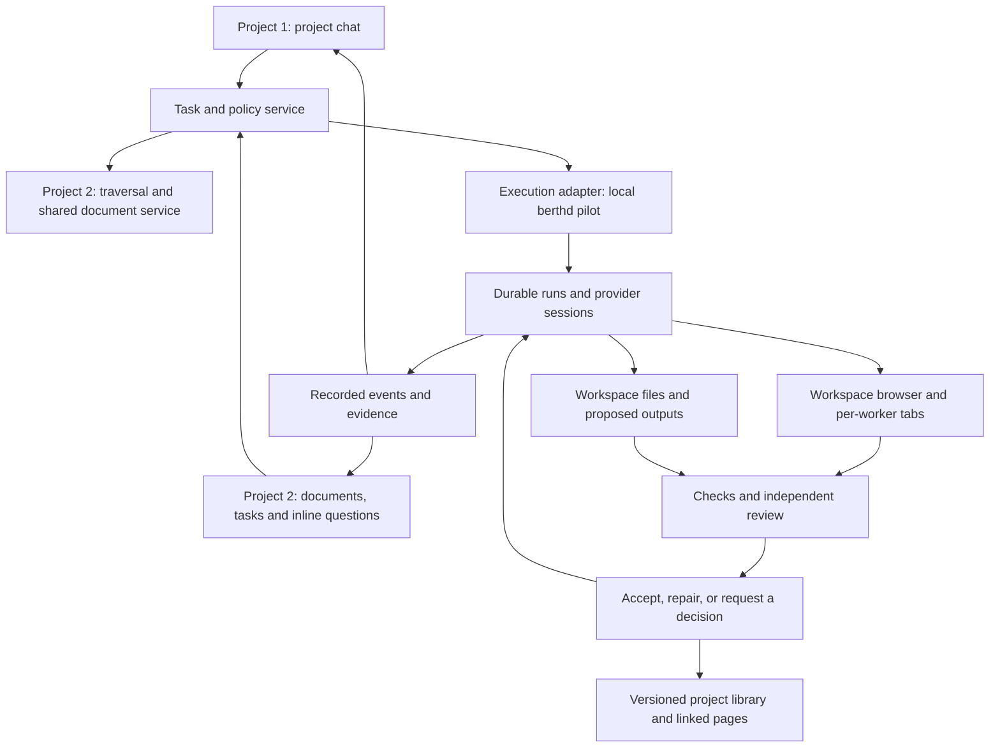

# Projects, agents, and the foundation for LeadingLight's harness

Research date: October 23, 2026, America/Los_Angeles. Revised October 24 into two sequential projects, including a source trace of Shipyard's agent browser. Proposal for discussion; no application behavior changed.

The concrete [Project 1 delivery plan](../PROJECT-1.md) supersedes this study's provisional build order. It selects Synara web interactions, Paseo delivery/session logic, and Shipyard environment/run components, with small independently verified releases. Work is outcome-driven: no mandatory planner/worker/reviewer process. The responsibilities discussed below remain optional harness building blocks.

## Recommendation

Build two projects in sequence. **Project 1 delivers capable agents working together through a project's chat**, with local/GitHub projects, file and command tools, connected browsers, services, outputs, and durable coordination. **Project 2 makes LeadingLight's documents, tasks, and results the main experience**, using the same execution system. Project 1 must be useful on its own before Project 2 starts.

Use **Paseo and Synara for the structure of a provider session**, **Shipyard for the working environment and execution mechanics**, and **selected coordination behaviors from all three**. Shipyard remains the first runtime reuse candidate. This replaces the earlier plan to make the document experience and background page editing prerequisites for the first project-chat release.

The user explicitly prefers copying as much working upstream implementation as practical and intends LeadingLight to be open source. Default to complete upstream services, components and tested modules. Write new code for integration and LeadingLight-specific behavior. A tracked fork or patch series is acceptable when it preserves more useful upstream implementation than a rewrite.

For the execution backend, the preferred first experiment is a pinned, local Shipyard `berthd` behind a small LeadingLight adapter. Prove that integration before committing to it. Do not embed three competing agent servers or rewrite an existing scheduler just to keep everything in Rust. Existing note conversations can keep their current runner during this transition.

The part LeadingLight should own is the relationship between a person's intent, their knowledge, the work commissioned, the evidence collected, and the result accepted. None of the three supplies that complete system in LeadingLight's object model.

The most useful interpretation of the proposed political system is **separation of authority**: someone defines the outcome, someone executes, someone checks, and recorded rules decide what may happen next. Begin with these responsibilities before inventing a large cast of agents.

## Two sequential projects

An **external linked project** connects a LeadingLight project page to an existing folder on disk or a GitHub repository checked out locally. LeadingLight holds the project's intent, reading, questions, tasks, decisions, and reports. The external folder holds its working files. Together they form one navigable project, with references across both sides.

Only these two source paths are in scope. A GitHub URL means a repository and its local checkout; GitHub Issues, remote project boards, other cloud connectors, remote execution, and conversation import are outside this proposal. A folder can contain code, documents, data, or creative work and need not use Git.

### Project 1: a capable project chat

The first product surface is a chat attached to the linked project. The user can ask an agent to inspect files, change them, run commands, start a preview, use its connected browser, generate outputs, delegate work, and have the results checked. Supporting views show the browser, files/diffs, artifacts, and worker progress. Existing note tools can supply context where useful; full traversal and task/report pages belong to Project 2.

Keep four responsibilities separate:

| Part | What it owns | Reference |
|---|---|---|
| Provider session | Native session handle, model/effort, turns, streaming, tool events, approvals, interruption, resume, capability discovery | Paseo's AgentClient/AgentSession; Synara's ProviderAdapter |
| Working environment | Root or worktree, shell processes, services/ports, browser contexts, downloads, screenshots, outputs and cleanup | Shipyard's box and worktree model |
| Coordination | Tasks, worker assignment, dependencies, messages, completion delivery, check/repair/review loops and limits | Shipyard's run mechanics; Synara's queue and role boundaries; Paseo's worker profiles and delegation |
| Project chat | User requests, answers, steering, decisions, worker status, evidence and deliverables | LeadingLight composition over the services above |

"Raw agent" means a real provider session with its supported tools, not a role prompt or a terminal transcript parser. Start with Claude Code and Codex. Preserve native capabilities through explicit adapters: file read/write, shell, skills and MCP/tools where supported, model settings, approval modes, resume and steering. Show unavailable capabilities honestly. A provider change keeps the task identity but uses a separate native session or a deliberate handoff. [Paseo contract][paseo-interface], [Synara contract][synara-adapter].

"All agent powers" is the capability target, implemented in slices that can be exercised. The first project's completion bar includes working file/shell tools, connected browser control, deliverables, and coordinated workers. It does not require every unrelated feature in the upstream products.

The coordinator can assign workers, receive their results, request review, and continue bounded repairs without the user moving messages between chats. Native provider subagents and independently managed workers remain distinct. The host owns reliable dispatch and completion delivery; the coordinator owns the plan and interpretation. The project chat presents the result and any decision that needs the user. [Shipyard orchestration][shipyard-orchestration], [Synara work queue][synara-hub-work], [Paseo delegation][paseo-workflows].

Use one authoritative session host and one execution journal. Defining a Paseo-like interface does not require running Paseo beside Shipyard or launching the same worker through both. First test whether an adapter over Shipyard's structured drivers can satisfy that interface. Compare this with reusing one upstream provider service if it preserves capabilities more directly. If a separate service owns provider sessions, Shipyard's run actions must call it; both must not launch or schedule the same worker. Choose by working capabilities, upstream code retained, and the changes we must maintain.

### Shipyard's browser runs in the agent's working context

The user's reference is specifically the agent browser. Source tracing establishes this path:

```text
Agent session: location + worktree environment; named tab selected per worker
    → berthd browser command
    → worktree browser API
    → Chromium on the execution host, controlled through a CDP pipe
    → tab with its own page, element refs, cookies, console and network state
          ↘ compact observations/screenshots to the agent
          ↘ live frames from that same tab to the app while watched
```

- **Context follows the worker's workspace.** The launcher supplies location/worktree IDs, project URL, ports and proxy settings. The browser CLI resolves that context automatically. `--tab` or `BERTH_BROWSER_TAB` selects a named tab; without one, agents share the main tab. LeadingLight should assign a tab ID for each worker automatically. [Environment][shipyard-browser-env], [command routing][shipyard-browser-cli].
- **The host owns Chromium.** It starts on demand, one process per active worktree, with a temporary profile. Named tabs use separate browser contexts and CDP sessions. One worker navigating or logging in therefore need not disturb another. Ownership is by worktree and tab, not inherently one Chromium process per agent. [Browser manager][shipyard-browser-core], [tabs][shipyard-browser-tabs].
- **Tools operate on that real browser.** Agents receive compact accessibility snapshots, stable element references until navigation, action deltas, screenshots, console messages and failed requests. Downloads go into the worktree. The app's agent view watches the same tab through streamed frames and does not control it; its ordinary human browsing surface is separate. [Browser API][shipyard-browser-api], [live viewer][shipyard-browser-view].
- **Networking follows the workspace.** The proxy routes the worktree's services and explicitly allowed public origins. This is not automatically the person's signed-in browser or an unrestricted web browser. General web research and project preview access need explicit capability choices. [Browser guide][shipyard-agent-browser].
- **Browser state is temporary.** Idle tabs close, profiles are removed when the browser ends, and stopping berthd closes its managed browsers. Saved viewport settings and captured evidence differ from live cookies/DOM state. Recovery must recreate a browser and re-establish the relevant page, not claim every browser action or login survives restart. [Browser manager][shipyard-browser-core], [tabs][shipyard-browser-tabs].

There is a concrete adaptation to prove: the browser API resolves a location plus an entry in its Git worktree list; an ordinary non-Git location has no such entries. LeadingLight needs browser ownership by a general workspace ID, including plain folders, without initializing Git in a user's folder merely to access the browser. The spike must establish whether that can be supplied through a narrow extension. [Target resolution][shipyard-browser-api], [location discovery][shipyard-locations].

**Project 1 is done when:** from a linked project's chat, the user can commission a real change/output; an agent uses files, commands and its browser; another worker checks the result; failures can lead to bounded repairs; and evidence returns to the chat. Closing and reopening the UI reconnects to the same work. A local non-Git folder and a GitHub checkout must both work. The browser can be watched live, but watching is optional. This source review has not run or validated that integration.

### Project 2: the experience starts with reading

The project page shows the current outcome, work underway, results ready to read, and decisions needing the user. Task pages, reports, and artifacts are linked objects using LeadingLight's existing pages, properties, relations, and lists. A Task can be a starter type with editable presentation; its capability and execution record bind to its stable page ID.

The user reads a brief or report and asks questions beside the relevant words. The answer can draw on the linked project, cite its sources, and link to an explanation or result page. Asking why something works is a question; asking to change it commissions work. Editing a draft or expressing an idea does not silently dispatch a task. A work request records the originating page and passage so the eventual result comes back to the same context.

For example: on a product brief, the user asks, "Make the import preserve my folders." LeadingLight records the task. A worker follows the brief's decisions and examples, inspects the linked repository, implements the change, runs checks, and publishes a report with the result and evidence. The project shows its status throughout. The user reads the report and asks about a tradeoff there; opening the worker's transcript is optional.

### Traverse the whole project, read what the task needs

Agents need a project traversal API, not only a snapshot of manually selected pages. It must expose page bodies and metadata, outgoing links, backlinks, relation properties, Thoughts and essays, attachments, tasks, reports, and results. On the external side it exposes directory listings, file search, file reads, and references inside supported documents. Links between a page, a task, and a file connect the two sides.

Every reachable item in the project's allowed scope must be discoverable through pagination. Agents follow links progressively and search within that scope; they do not load every document into each prompt. Cycles are deduplicated, broken links remain visible, and unsupported files are listed with their reading limitations. A report must distinguish evidence actually read from files merely discovered.

Project membership is separate from a casual link. Shared reference pages can be included without granting access to every unrelated page connected through a common tag or person. The project binding records the allowed knowledge scope and external roots; a task inherits these. A link identifies something to resolve, not permission to expand the project. Within that scope, traversal can continue across many hops without the user attaching every page to a chat.

References need stable page IDs, external-root IDs and relative paths, plus page revisions or file hashes/commit IDs for evidence. Return the relationship and source location with each reference. Existing Markdown export renders mentions as titles and page reads omit properties; extending those text tools alone would lose part of the project's structure. Reuse the existing link data and derive relationships from it, preserving Decisions 9 and 11. No separate graph database is required initially.

### Agents manage work through LeadingLight

The background tool surface needs to discover/read project context; create and claim tasks; record dependencies, progress, and blockers; publish linked reports and artifact versions; and request a decision when necessary. Routine bookkeeping must not rely on a worker remembering to narrate it. The execution service records starts, interruptions, checks, failures, and completion; the worker contributes the explanation and evidence.

Task state has one authoritative record. The task page and project lists show that record, and user actions send commands back to its owner. A worker's report cannot mark a failed run successful. Task completion requires the agreed output and checks; independent review applies when the task calls for it. Every state change and report links back to the task, originating request, attempt, and resulting files.

Project 2 requires background access to LeadingLight. Status updates and new reports must persist with the relevant page closed and the UI disconnected. A shared service owns writes and notifies open editors. Changes to existing prose use revisions and preserve unsaved user edits; a conflict becomes a specific decision. Project 1 already persists execution/task records outside the UI; Project 2 connects them to pages rather than recreating the task system.

### Autonomy should reduce the attention required

Within an agreed outcome, scope, and limits, workers proceed, check results, repair bounded failures, and continue dependent work. The user sees meaningful progress, completed outputs, and concrete exceptions. A decision page explains what is blocked, what was tried, and what choice is needed; routine tool calls and retries remain in optional run details. Pause and stop remain reachable from the task or project.

Project 2 is successful when the user commissions work from a document, leaves the agent panel closed, and later finds an accurate task state and a useful report linked to the result. It must also handle a question requiring both a linked LeadingLight document and an external file. The coordinator, execution recovery, checks and task identities come from Project 1.

## What was studied

I cloned the three repositories and traced provider adapters, project/workspace models, persistence, coordination, restart behavior, and artifact handling. I also read LeadingLight's current implementation, decisions, and vendoring script. Findings below distinguish source behavior from proposed adaptations. Upstream applications and test suites were not run; this is a source study, not a runtime certification or an exhaustive security audit.

| Repository | Inspected revision | License declared by repository |
|---|---|---|
| Paseo | [`a54cc6dd11f7`][paseo-head] | [Apache-2.0, with third-party components under their own licenses][paseo-license] |
| Synara | [`29b11e105200`][synara-head] | [MIT; notices name T3 Tools and Emanuele Di Pietro][synara-license] |
| Shipyard | [`12d35552d515`][shipyard-head] | [MIT; notice names Sean Brydon][shipyard-license] |
| LeadingLight | `0d10f704cea37dd184122143f5cae804dfcb89a0` | Current checkout; clean before this study |
| LeadingLight's vendored Shipyard | `ea121592dc8bd6823e9fbcbff2bdf45d95b1b269` | Existing subset, recorded as v0.3.30 |

These are inspected commits, not a claim that every feature is in the latest stable release. Synara explicitly distinguishes stable and beta capabilities. Links below pin evidence so future upstream changes do not silently change this recommendation.

## LeadingLight already has a useful agent, but its unit of work is a note

| What exists | Consequence for this project |
|---|---|
| Real Claude Code and Codex subprocesses, resumed per provider | Preserve the provider integrations and the familiar composer. This is an extension of working functionality. |
| `@` agents loaded from agent files | These are prompt/model presets. They are not independently scheduled workers with task ownership. |
| Page read/search/create/edit tools | A strong knowledge bridge already exists. Its scope and execution location need to change for project work. |
| Note threads in `localStorage` | Persistence keeps at most 20 threads per page, truncates tool output to 4,000 characters, and omits live approvals. It cannot be the audit record for durable work. |
| Rust owns the child process; TypeScript in the webview drives turn logic | Switching notes can preserve a running thread, but there is no independent durable job controller. |
| Note edits require the target's live editor | A worker cannot safely continue editing that note after its editor disappears. Preserve the single-writer rule. |
| Media blocks and files copied into app storage | Useful asset storage and presentation, but no first-class generated artifact identity, version history, review state, or provenance. |
| Shipyard frontend code vendored verbatim | A substantial UI donor is present. The Go daemon, run engine, artifact service, and supporting proxy are not thereby integrated. |

Evidence: [provider launch][ll-agent], [turn handling][ll-turn], [thread storage][ll-threads], [agent presets][ll-agents], [page tools][ll-tools], [assets][ll-assets], and [vendored scope][ll-upstream].

The project launch configuration must be separate from note mode. Current turns use an app-data working directory. Codex is launched with shell, hooks, apps, plugins, multi-agent, image generation, and goals disabled; its thread uses a read-only sandbox. Claude is given empty settings sources, a strict notes MCP configuration, and only web search/fetch as built-in tools, plus the plan-exit tool in Plan mode. Simply adding a folder picker will not turn these note sessions into project workers. Conversely, changing their working directory without reviewing settings and tool access would change what the existing note assistant can do. [Launch configuration][ll-agent], [Codex configuration][ll-clis], [Codex thread setup][ll-turn].

The older milestone and deferred notes sometimes lag the code, including the deferred Codex-provider entry. The working implementation is the baseline for this proposal.

## 1. Paseo: a strong boundary between agent runtimes and their clients

**Philosophy:** agents run on a host; desktop, mobile, web, CLI, and other agents are clients of that host. The daemon owns runtime access. The product includes workspaces, terminals, editing, diffs, browser previews, and orchestration. Its TypeScript client is an explicit integration surface. [Overview and client example][paseo-readme].

The useful decomposition is:

```text
Client / CLI / MCP
        ↓
Daemon: workspace registry, agent manager, schedules, plugins
        ↓
Provider registry → AgentClient → AgentSession
        ↓
Claude SDK / Codex app-server / ACP and other provider runtimes
```

`AgentClient` creates and resumes sessions, discovers catalogs, and can expose history import. `AgentSession` runs turns, streams events, answers permissions, interrupts, and releases resources. A persistence handle retains provider identity and the native session identifier. Capability flags describe real differences, including MCP, reasoning streams, mode changes, and kinds of rewind. This is a better model than pretending every provider implements the same buttons. [Current interface][paseo-interface], [provider registry][paseo-registry].

Its project/workspace model distinguishes directories, local checkouts, and worktrees. Workspace identity is separate from a branch's display name. That matters for a renamed research folder as much as for a code branch. [Workspace records][paseo-workspaces].

Agent metadata is stored independently of the UI, including configuration, persistence handles, attention state, and ownership. The manager serializes lifecycle work and handles session reload and history reconstruction. Do not mistake its in-memory timeline view for the entirety of persistence. [Agent storage][paseo-storage], [manager][paseo-manager].

Paseo distinguishes its own delegated agents from provider-native subagents. A delegated agent is a full session that can be followed up, moved in the hierarchy, or independently inspected; native subagents remain provider-managed. Schedules launch fresh agents, while heartbeats prompt an existing agent. [Coordination workflows][paseo-workflows], [schedules][paseo-schedules].

**Important limit:** daemon independence from the UI does not mean an interrupted workflow automatically resumes its steps. The schedule service marks an in-flight scheduled run failed after daemon restart and advances overdue schedules. Do not present this as equivalent to Shipyard's run journal. [Restart handling][paseo-schedule-service].

**Take:** capability discovery; provider/native-session separation; workspace identity; the distinction between a durable worker and a native subagent; client/daemon separation; attention state.

**Adapt:** keep Claude and Codex first. Map model options and approval support explicitly. Choose profiles by role without making role names provider-specific.

**Cost of wholesale reuse:** a Node daemon and its protocol/storage/plugin ecosystem alongside Tauri. Its Expo/React Native application and Electron desktop shell do not match LeadingLight's frontend. The client API is a more plausible reuse boundary than copying its app. Paseo is the fallback runtime candidate if the Shipyard integration proves too tied to its box/session model. [Packages and stack][paseo-package].

## 2. Synara: the closest product reference for the intended harness

**Philosophy:** a project provides context; a thread owns a task; a provider session executes it; files, previews, changes, and approvals stay close to the conversation. Its Hubs extend this into coordinated work across repositories or without a repository. [Overview][synara-readme], [Hubs][synara-hubs].

The useful decomposition is:

```text
Desktop/web UI or scoped agent gateway
        ↓
Commands → decision logic → durable events and receipts
        ↓
Projections for the UI + reactors that perform work
        ↓
ProviderService → provider adapters → native runtimes
```

The orchestration engine accepts commands, deduplicates retries with receipts, orders work within an aggregate, and commits events and the immediate read model together. The provider layer records canonical runtime events before publishing them. This is valuable evidence for designing retry and reconnect behavior; it is also a large Effect-based subsystem, not a small component to paste into LeadingLight. [Engine contract][synara-engine-contract], [engine implementation][synara-engine], [runtime event handling][synara-provider-service].

Hubs are particularly relevant:

- A coordinator, worker chats, shared instructions and memory, and a Library of outputs.
- A persistent work queue with concurrency limits and stable task keys.
- Code workers can use isolated worktrees; general work can use a local folder.
- Original user requests and attachment references accompany delegated briefs.
- Worker approvals remain human decisions; the coordinator does not gain permission to approve them.

The product documentation describes these behaviors, and the work service implements queue records, claims, reconciliation, revisions, and retry identity. [Hubs][synara-hubs], [work service][synara-hub-work], [gateway queue routing][synara-hub-gateway].

The most valuable detail is **who is allowed to do what**. Context packets separate human instructions, host policy, server state, agent-maintained memory, and reports from other agents. Workers receive their assignments without the coordinator's playbook. Server-side principals distinguish user, coordinator, worker, and ordinary member; several configuration and goal operations remain user-owned. This is a direct architectural precedent for the proposed political system. [Context packets][synara-context], [principals][synara-principals].

Synara also has persistent thread goals, automatic continuation with priority for user input, schedules, provider handoffs, history import, document/output surfaces, inline visuals, and an external MCP boundary. Its Library uses a managed Git directory with containment rules and history operations. That is more useful for durable desk-work outputs than making every file an incidental chat attachment. [Goals][synara-goals], [Library implementation][synara-library], [external MCP][synara-external], [project/history import][synara-import].

**Important limits:** after server restart, orphaned provider turns are settled as interrupted; an event log alone does not preserve a running process. Multi-folder access is supported only for specified providers, and the documented Git/checkpoint recovery covers the primary folder, not all folders atomically. Remote connectors are channel- and provider-dependent. [Startup recovery][synara-recovery], [multi-folder constraints][synara-folders], [connectors][synara-connectors].

**Take:** the Hub concept; role-scoped authority and context; durable task identity; goals distinct from turns; original-request provenance; output library; recovery semantics; human decisions collected in one place.

**Adapt:** express shared instructions, decisions, briefs, and reviewed findings as LeadingLight pages. Keep accepted artifacts in a project library. The coordinator should explain exceptions and decisions, while the system performs routine dispatch and bookkeeping.

**Cost of wholesale reuse:** Electron desktop APIs, a substantial TypeScript/Effect server, its contracts and migrations, and many cross-cutting services. Prefer copying coherent services with their required contracts and tests where that saves work. Trace those dependencies before extracting a module; avoid introducing a second authoritative task backend. [Desktop package][synara-desktop], [engine implementation][synara-engine].

## 3. Shipyard: the best primary implementation upstream for this checkout

**Philosophy:** the app is a view; the machine doing the work owns sessions, worktrees, services, and automations. `berthd` runs on the execution machine, `berth` connects clients to it, and the Tauri/React/COSS app presents the work. Locations can be ordinary directories; creating worktrees requires Git. [Architecture][shipyard-architecture], [locations][shipyard-locations].

The useful decomposition is:

```text
Tauri app / CLI / MCP
        ↓
berth connection layer → berthd
        ↓
Locations, worktrees, sessions, artifacts, hooks, durable runs
        ↓
Driver interface → terminal or structured provider protocol
        ↓
Agent host / tmux / installed agent CLI
```

The driver interface isolates sending, interruption, permission modes, answering, and conversation access. The implementation includes structured Claude stream-json, Codex app-server, and ACP drivers alongside the terminal driver. Some comments still describe the earlier terminal-only state; the dispatch code is stronger evidence. The agent host owns the subprocess, appends its input/output history, and exposes attach/write/stop over a socket. [Drivers][shipyard-driver], [agent host][shipyard-host].

**The standout is the durable run engine.** It owns control flow, concurrency, budgets, gates, timers, and a journal; a `Host` interface supplies leaf actions. That separation lets the same execution ideas apply to a report or launch package, even though many current templates are Git-oriented. [Engine boundary][shipyard-engine], [journal][shipyard-journal].

Its patterns include check/fix loops, independent review, handoff packets, broadcast, and competing attempts. Restart handling is explicit per operation: completed steps are reused; waits follow the same turn; uncertain prompt delivery can require a decision; commands/checks may run again. Notifications and external effects still need idempotency at their destination. This is recovery with stated limits, not a blanket exactly-once guarantee. Tests cover prompt re-entry, durable gates, budgets, cancellation, and attempts. [Run semantics][shipyard-runs], [host re-entry implementation][shipyard-run-host], [run tests][shipyard-run-tests].

Artifacts are another strong donor: registered files, typed renderers, provenance, live updates, validation, and retained versions. Supported kinds include charts, tables, diagrams, Markdown notes, HTML pages, and visual diffs. HTML execution is isolated through a proxy and sandbox policies; mounting its React viewer alone does not recreate that boundary. [Artifacts][shipyard-artifacts], [store][shipyard-artifact-store], [HTML proxy][shipyard-artifact-proxy].

**Important limits:** the operational model brings Go binaries, tmux, local/remote connections, and Git-oriented workflows. Worktree separation does not prevent shell access elsewhere. Shipyard's own hook documentation says gates are operational controls, not a security boundary. Artifact retention is bounded, and artifacts are tied to worktree lifecycle. LeadingLight needs separate retention for accepted outputs. [Architecture][shipyard-architecture], [hooks][shipyard-hooks], [artifacts][shipyard-artifacts].

**Take:** the UI already being tracked; durable runs; protocol drivers; supervised sessions; review/check loops; artifact presentation and registration; declarative setup where it fits.

**Adapt:** one local execution host first; folders as first-class project sources; a project library independent of worktrees; checks appropriate to each output; an explicit LeadingLight policy bridge.

**Why it wins as primary upstream:** stack compatibility is already proven by the existing vendor integration, and its run engine addresses the hardest new requirement: work continuing through loss of the UI and recoverable service interruptions. This is an architectural fit judgment, not a claim that it has fewer bugs or a guaranteed maintenance future.

## Feature choices

“Found” means visible in the inspected source or its accompanying documentation. It does not imply equal maturity or identical provider support. “Not established” means this study did not establish an equivalent feature.

| Capability | Paseo | Synara | Shipyard | LeadingLight choice |
|---|---|---|---|---|
| Existing folder, including non-Git | Directory workspace | Local/non-Git work and Hubs | Directory location | First milestone; link in place |
| Git worktree per task | Found | Found | Found | Use for concurrent code writers |
| Several roots per project | Not established as equivalent to Synara | Explicit, with recovery limits | Project locations across boxes | One root first; root list in model |
| Multiple providers | Registry and session contract | Adapter/service contract | Driver contract and presets | Claude and Codex first; capabilities determine UI |
| Resume native conversation | Found | Found | Found, provider-dependent | Preserve opaque provider handles |
| Delegated workers | Full agents plus native children | Hub workers plus native children | Sessions, helpers, run steps | Own task IDs and worker roles |
| Persistent coordinator workspace | Agent orchestration and schedules | Hubs directly address this | Compose from runs and sessions | Adapt Synara's product model |
| Fresh scheduled work / existing-thread wakes | Schedules / heartbeats | Standalone, dedicated, heartbeat modes | Scheduled/event flows | Add after reliable single-task execution |
| Step-by-step restart recovery | Not equivalent to Shipyard runs | Event replay and turn reconciliation | Explicit run journal and re-entry | Shipyard is preferred donor |
| Checks and bounded repair loops | Agent-driven workflows | Goal/coordination workflows | Built-in run templates | Required before autonomy expands |
| Human decision inbox | Agent attention state | Hub/task approvals and review grouping | Review inbox, waiting gates | One calm “Needs you” list |
| Role and context provenance | Ownership/provider boundaries | Explicit Hub principal/context model | Origins and operation gates | Adapt Synara; enforce outside prompts |
| Provider conversation import | Adapter import capabilities | Project/history import workflow | Transcript/session access | Later; copy safely and deduplicate |
| File editor, terminal, browser, diffs | Found | Found | Found | Reuse selectively for coding projects |
| Versioned generated outputs | Equivalent registry not established | Library and inline visuals | Typed, versioned artifacts | Shipyard renderers + LL retention |
| Office/media production | Runtime tools can produce files | Output/Studio/Library surfaces | Artifact/file surfaces | Add generation tools and format checks separately |
| Remote devices | Broad mobile/web/daemon design | Remote mode exists; not audited here | Remote boxes and companion | Later; local first |
| Plugins and tool integrations | Broad daemon/client/provider plugins | Internal gateway, external MCP, connectors | UI plugins, skills, kits, hooks | Scoped tool registry first; ecosystem later |

Feature evidence is in the repository sections above. Additional references: [Paseo workflows][paseo-workflows], [Synara automation modes][synara-harness-policy], [Synara output-oriented work][synara-studio], [Synara inline visuals][synara-inline], [Shipyard orchestration][shipyard-orchestration].

## The architecture LeadingLight should own

### Keep the knowledge model; add execution records beside it

A Project stays a page with editable properties and relations. Attach a project capability by stable page ID; do not make the mutable display name “Project” a special backend type. Store execution state in dedicated records, not in the page's prose or arbitrary property JSON.

| Record | Responsibility |
|---|---|
| Project binding | Page ID, attached roots, instructions, linked knowledge, output library, policy revision |
| Workspace | Host and working directory; directory/checkout/worktree; ownership and cleanup rules |
| Task | Linked page ID, requested outcome, originating page/passage, acceptance criteria, dependencies, role assignments, state |
| Run and steps | One attempt to perform a task; inputs, event cursor, checkpoints, limits, results |
| Provider session | Provider-native handle and capabilities; replaceable without changing task identity |
| Artifact and versions | Stable output identity; immutable bytes/hash, producing run, preview, review status |
| Decision | Who allowed/rejected what, for which task, action, policy revision, and artifact version |

“Agent” must stop meaning three different things. A **profile** is instructions/model preferences; a **worker** is an assigned executor; a **provider session** is its runtime conversation. LeadingLight currently has profiles and sessions. The harness needs workers and tasks.



This is a proposed ownership diagram, not a claim that these services are already implemented. Use one owner for a run's state: if berthd executes the run, its journal is authoritative for execution; LeadingLight stores its task mapping, policy, decisions, and output records. Do not create a second scheduler that races the first.

### Import means attaching a source, not copying every file into a note

Offer two entry points: link an existing folder, or clone a GitHub repository into a chosen local location and link the checkout. Reuse an existing checkout when the user selects it. Record the repository source separately from the local root. Fetching updates must not silently replace local edits or switch a task's working revision. Files remain in the linked folder; LeadingLight stores references and retains accepted output versions.

Record a canonical root and a stable binding. If a root moves, offer relinking. If it disappears, show it as unavailable and preserve tasks/history. Detaching a project removes the association; deleting source files is a separate explicit operation. Project setup scripts and imported hooks need a deliberate trust decision before execution.

For Git tasks, isolated worktrees protect concurrent edits. For non-Git tasks, start with one writer per root or a managed output copy. Two workers writing the same spreadsheet or design file need serialization or an explicit merge strategy. Worktree-like parallelism is not available merely because the UI shows separate chats.

The same model should support these three first-use stories:

| Project | Inputs | Result and evidence |
|---|---|---|
| Product feature | Existing repository, a brief page, linked design decisions | Isolated change, passing checks, screenshots, reviewer findings, and a decision to merge |
| Desk research | Existing folder of documents/data, selected reading notes, a question | Sourced memo and chart; checked calculations and citations; retained PDF or document file |
| Creative launch | Brand files, product notes, audience and output brief | Copy and media variants from available tools; format checks and visual review; selected versions retained |

All three begin with an outcome and end with inspectable work. Git operations appear only where they apply. Creating a media variant requires a configured generation tool; displaying an image does not supply that capability.

### Project 2: make the knowledge bridge usable beyond an open editor

Expose the project's allowed linked web through structured traversal and search, with IDs and revisions. The worker chooses relevant material progressively; the user need not preselect every page. Keep human instructions distinct from quotations, source documents, and agent memory.

Move task updates and report publication behind a service available independently of the webview. It must own persisted writes, serve open and closed pages, and notify the UI. Existing prose edits carry a base revision; editor coordination must preserve unsaved changes and undo. A stale edit becomes a conflict, while task state and separate reports can continue to update. Preserve the no-lost-update rule in Decisions 3 and 9.

The current per-turn in-process notes MCP bridge cannot simply be handed to an external daemon. Expose a task-scoped bridge to the shared service. Materialized context files may help test the runtime adapter, but cannot satisfy the final requirement to traverse current project context and manage work inside LeadingLight.

### Separate permissions from model behavior

The task policy defines readable roots, writable roots, tools, network/external actions, concurrency, and limits. Provider capabilities determine what can actually be enforced. A working directory is not a filesystem sandbox; neither a role prompt nor a `before:` hook can contain an unrestricted shell. Reject unsupported policy combinations or explain their actual scope.

Preserve note mode. Introduce project mode with explicit permissions rather than enabling every tool for every old conversation. A coordinator may allocate authorized work but cannot enlarge its budget, alter the person's standing rules, or approve its own worker's escalation. Emergency stop and policy changes are host operations.

On a local Mac, closing the UI and sleeping the computer are different events. A background service can outlive the UI; local computation pauses during sleep. Truly continuing while the Mac sleeps requires a separate awake host.

## Assets and artifacts: use what exists, then add the missing contract

An **asset** is a stored file. An **artifact** is a named deliverable with origin, versions, and review status. A **preview** is how it is displayed. Generation, storage, preview, and verification should be separate capabilities.

| Output | Reuse now | Extension needed |
|---|---|---|
| Notes, briefs, research | Existing editor, page links, page tools | Proposed edits, source references, version/review linkage |
| Images, audio, video | Existing media blocks and asset storage | Generation/import tools, metadata, provenance, previews of changed versions |
| CSV/JSON tables, charts, diagrams | Shipyard artifact types and viewers | Real registration service; persistence beyond worktree removal |
| Interactive HTML | Shipyard artifact isolation design | Full host boundary and policy; verify on Tauri WebKit |
| PDF, DOCX, XLSX, PPTX | Store as files; open externally where needed | Generator/converter tools, previews, format-specific verification |
| Software | Worktree, diff, terminal/browser surfaces | Build/test evidence tied to the exact revision being reviewed |

Do not promise native editing of Office formats merely because a provider can generate them. Start with file production, a usable preview or external open, and validation. For example, a spreadsheet check should inspect formulas and totals; a document check should inspect rendered pages; media checks should inspect dimensions/duration and the output itself.

Accepted outputs should survive a task archive and worktree cleanup. Store immutable versions in a LeadingLight-managed library, link them from pages, and keep the producer/task/inputs/checks. A later revision invalidates the earlier approval until reviewed again. Shipyard's bounded scratch-artifact history is useful during work but should not define retention of a person's finished work.

## A minimal political system that can earn more autonomy

The following is a proposed interpretation, not an assumption about the details of your eventual system.

| Responsibility | First implementation |
|---|---|
| Set direction | You write or discuss an outcome, constraints, and examples of acceptable quality |
| Record standing rules | Versioned project instructions and host-enforced policy |
| Plan and allocate | One coordinator proposes tasks and dispatches within those rules |
| Execute | A worker produces changes or deliverables in its assigned workspace |
| Check | Deterministic checks where possible, plus an independent reviewer with a fixed rubric |
| Decide exceptions | A short “Needs you” queue with evidence, options, and a recommendation |
| Preserve institutional memory | Accepted decisions and findings linked back into LeadingLight |

A worker finishing a turn only means it stopped speaking. Task completion needs expected artifacts, passing checks, and the required review. A model majority is not independent evidence; reviewers should inspect the actual result against the brief. Do not make the coordinator invent both the success criteria and its own verdict after the fact.

Use this first loop:

```text
Brief → bounded plan → worker → checks → independent review
                                  ↑              |
                                  └── repair ────┘
                                     or decision → accept and retain
```

Budget the loop, preserve failed attempts, and stop when work is blocked, authorization is missing, or repeated repairs make no progress. Prefer completion events for the next step; reserve periodic wakes for things that actually need periodic observation. Alert on a meaningful decision, failure, or completed deliverable rather than narrating every agent action.

The intended benefit is that routine follow-through no longer depends on how engaging the task feels that day. Your judgment remains central to direction and consequential choices. Evaluate the harness by accepted outputs, defects, time waiting, cost, and the number of decisions you had to make—not by worker count or message volume.

## Build order and proof required

### Project 1: establish the working system in project chat

| Step | Concrete result |
|---|---|
| 1A. Runtime and environment spike | A pinned local berthd behind a provider-session interface; Claude and Codex launch/resume, file/shell tools, capability discovery, approvals, cancel and reconnect work. |
| 1B. Connected browser spike | Agent opens a workspace page, acts on it, captures evidence, and the user watches the same tab. Two workers keep separate browser state. Prove the plain-folder adaptation and recreation after browser loss. |
| 1C. Linked project chat | Link a local folder or clone/link GitHub; request work in chat; inspect changes, running services, browser and outputs. Record task/run/session/artifact IDs and durable events from the start. |
| 1D. Coordinated work | A lead agent delegates, receives completion events, runs checks, requests independent review, and repairs within limits. Outcomes and decisions return to the project chat. |
| 1E. Reliability gate | Reopen the UI without losing work; reconcile service interruptions; avoid duplicate dispatch; retain decisions and accepted outputs; stop workers and pending continuations. |

The browser is part of the execution environment and can serve any supported provider. It must not depend on keeping the chat panel mounted. Verify an ordinary folder as well as a Git checkout. Browser recovery is a separate concern from provider-session and run recovery.

**Go/no-go:** use berthd if the provider contract, browser environment and durable coordination work with a maintainable adapter or tracked patch set, without changing global provider configuration. Do not reject useful reuse merely because it requires a fork. If the spike fails, evaluate Paseo's published client/daemon boundary or a coherent Synara provider service, together with the cost of connecting the required Shipyard mechanics. Compare retained upstream code, adapter dependencies, behavior and update burden. A new runner is the last option. The source study does not count as a completed spike.

### Project 2: make LeadingLight the primary experience

| Step | Concrete result |
|---|---|
| 2A. Connected project knowledge | Traverse documents, links, backlinks, properties, attachments and external files with stable IDs and source revisions. |
| 2B. Tasks and reports as objects | Project 1's durable records appear in task pages and project lists; background workers publish linked reports through a shared write service. |
| 2C. Work from reading | Questions beside text use the project's context; work requests link to their source passage and results return there. |
| 2D. Quiet operation | Routine progress and completed work are readable in the project; exceptions appear as concrete decisions; the agent panel can stay closed. |

Build this against Project 1's existing commands, records and events. Keep task state, runs, sessions and output identity independent of chat messages from the start, so Project 2 adds an experience and knowledge bridge instead of replacing the execution system. Preserve existing note conversations separately; history import is not required.

### Outside this scope

Cloud connectors, remote execution, conversation import, cross-project orchestration, and general scheduling are not part of this proposal. Add file readers, generators, and previews only as a linked project's actual deliverable requires them. The broad upstream feature inventory above is research, not an implementation backlog.

Before implementing each milestone, turn its behavior into Gherkin. Project 1's critical acceptance seams are:

| Scenario | Concrete expected result |
|---|---|
| Attach a folder with spaces; attach it again via an alias | One canonical binding; existing contents preserved |
| Link a GitHub repository, then select its existing checkout | One external binding; local edits and checkout location preserved |
| Rename or unplug its root | Project becomes unavailable; relink restores access and retains history |
| Run a task from project chat | File/shell tools use the intended root and outputs return to the initiating chat |
| Watch an agent click in its connected browser | The live view shows that same tab and the resulting page state |
| Two workers navigate or sign in concurrently | Assigned tabs keep independent pages, element refs and cookies |
| Use the browser in a plain-folder project | No Git initialization required; files, downloads and evidence stay associated with its workspace |
| Browser closes during a run | Loss is explicit; worker recreates the browser and re-establishes context without blindly repeating a submission |
| Worker finishes while its coordinator is busy | Completion is delivered to the right task at a safe point; no manual message relay |
| Retry a start request after losing the response | Same task/run returned; no second process |
| Close/reopen the UI during a turn and during an approval | Reconnect to the same work; approval remains actionable or is explicitly invalidated |
| Restart the service between a side effect and its acknowledgment | Reconcile the result; uncertain external effects are not blindly repeated |
| Two non-Git workers attempt the same output path | Serialize, isolate, or report a conflict; no silent overwrite |
| Reviewer accepts v1; worker produces v2 | Acceptance still refers to v1; v2 requires its own review |
| Archive a worktree after accepting its artifact | Accepted bytes, provenance, and preview remain available |
| Stop a goal while workers or retries are pending | No new work launches; cancellation and remaining outputs are recorded |
| Open generated HTML | No app bridge, app credentials, or arbitrary network access |

Project 2 adds these seams:

| Scenario | Concrete expected result |
|---|---|
| Ask a question whose evidence spans a relation, a backlink, and an external file | Answer follows those references and cites the actual pages and file revision |
| Traverse a cycle, a broken link, and more than one page of results | No endless loop or silent truncation; missing context is reported |
| Follow a shared tag into an unrelated project | Scope does not silently expand; accessible project references remain traversable |
| Commission work from a document and close its page and agent panel | Task state and a linked report persist without reopening either surface |
| Ask about a report without requesting more work | Answer uses its project context; no new work task starts |
| Change a cited note while a worker prepares a patch | Stale patch is held as a conflict; unsaved edits survive |
| Open the same task through chat and its page | Both show the same record, history and artifact versions |

These guard ownership, persistence, and authority boundaries. Keep tests focused on those seams rather than mirroring every helper.

## Keep upstream improvements without losing our product

Default to reuse in this order: consume an existing service/package; vendor a coherent module with its dependencies and relevant tests; maintain a small fork when needed; write new implementation only for the remaining gap. Keep source commits and notices with copied code. The inspected repositories declare MIT (Shipyard, Synara) and Apache-2.0 (Paseo); retain their license files and applicable third-party notices when carrying source or binaries.

| Area | Copy/reuse target | LeadingLight work |
|---|---|---|
| Browser | Shipyard's host manager, CDP tools, proxy, tabs, live stream and viewer together | General workspace ownership, automatic worker-tab binding and product integration |
| Working environment | Shipyard's sessions, service management, ports, worktrees and process cleanup | Link existing folders/GitHub checkouts and preserve plain-folder support |
| Runs and evidence | Shipyard's journal, run templates, completion delivery, checks and artifact implementation | Task mapping, retained outputs and project-chat presentation |
| Provider sessions | One coherent upstream implementation; compare Shipyard drivers with Paseo/Synara services | Expose the chosen lifecycle/capability contract and fill demonstrated gaps |
| Coordination | Reusable Synara queue/context/principal modules and Paseo delegation/profile logic where dependency cost is justified | Connect them to the single chosen task/run owner |
| UI | Existing Shipyard vendor plus suitable upstream chat, worker and artifact components | COSS composition and LeadingLight navigation; retain the repository's vendor rules |

Copying an implementation includes the behavior it depends on. In particular, the browser viewer needs the browser host, proxy and streaming API; a provider adapter needs its event, approval and persistence contracts. A copied React component or interface alone is not equivalent to reusing that feature.

There are three distinct reuse modes:

1. **Track verbatim source:** continue the Shipyard UI approach. Pin commits, retain notices, and keep LeadingLight adaptations outside the vendor tree.
2. **Consume a runtime through a protocol:** prefer this for berthd or the fallback Paseo daemon. Pin the binary/protocol pair and test capabilities. Do not assume a bundled library with a stable API: Shipyard's run engine currently lives under Go `internal/`.
3. **Vendor or fork a coherent implementation:** use this where there is no suitable public package or protocol boundary, including coordination modules. Preserve its contracts and relevant tests. Record the upstream commit and keep our changes small and separately identifiable. Translate only when the runtime boundary requires it; copied logic will not update itself.

Do not make application state a mirror of three upstream databases. LeadingLight owns project-page bindings, tasks, accepted outputs, and decisions. The chosen runtime owns its sessions and execution journal. An adapter translates and records explicit IDs and cursors.

Before increasing the vendor surface, fix a concrete issue in the current sync script: failed `git apply --3way` calls are followed by `echo`, and the script still advances `UPSTREAM.json` to the requested revision. This can mark a conflicted or incomplete import as fully updated. Advance the recorded commit only after all patches succeed and the required checks pass. The finding is recorded in `docs/DEFERRED.md` because this task studies architecture rather than changing the sync workflow. [Current script][ll-sync].

For every runtime or vendor update, inspect changes to protocols, permissions, migrations, defaults, cleanup, and artifact rendering. Re-run the corresponding acceptance seams, retain a rollback path compatible with the stored data, then advance the pin. A weekly comparison can be useful later; this study has not created an automation.

Keep the scope of the first architecture decision small: **LeadingLight owns knowledge and work intent; execution lives behind a replaceable host interface; Shipyard is the first implementation candidate.** The political system can then evolve in ordinary data, policies, and run templates without another rewrite of the editor or provider integrations.

[paseo-head]: https://github.com/getpaseo/paseo/commit/a54cc6dd11f73864fc78100a9587010274ba1e10
[paseo-license]: https://github.com/getpaseo/paseo/blob/a54cc6dd11f73864fc78100a9587010274ba1e10/LICENSE
[paseo-readme]: https://github.com/getpaseo/paseo/blob/a54cc6dd11f73864fc78100a9587010274ba1e10/README.md
[paseo-package]: https://github.com/getpaseo/paseo/blob/a54cc6dd11f73864fc78100a9587010274ba1e10/package.json
[paseo-interface]: https://github.com/getpaseo/paseo/blob/a54cc6dd11f73864fc78100a9587010274ba1e10/packages/server/src/server/agent/agent-sdk-types.ts
[paseo-registry]: https://github.com/getpaseo/paseo/blob/a54cc6dd11f73864fc78100a9587010274ba1e10/packages/server/src/server/agent/provider-registry.ts
[paseo-workspaces]: https://github.com/getpaseo/paseo/blob/a54cc6dd11f73864fc78100a9587010274ba1e10/packages/server/src/server/workspace-registry.ts
[paseo-storage]: https://github.com/getpaseo/paseo/blob/a54cc6dd11f73864fc78100a9587010274ba1e10/packages/server/src/server/agent/agent-storage.ts
[paseo-manager]: https://github.com/getpaseo/paseo/blob/a54cc6dd11f73864fc78100a9587010274ba1e10/packages/server/src/server/agent/agent-manager.ts
[paseo-workflows]: https://github.com/getpaseo/paseo/blob/a54cc6dd11f73864fc78100a9587010274ba1e10/public-docs/orchestration-workflows.md
[paseo-schedules]: https://github.com/getpaseo/paseo/blob/a54cc6dd11f73864fc78100a9587010274ba1e10/public-docs/schedules.md
[paseo-schedule-service]: https://github.com/getpaseo/paseo/blob/a54cc6dd11f73864fc78100a9587010274ba1e10/packages/server/src/server/schedule/service.ts#L620-L670
[synara-head]: https://github.com/Emanuele-web04/synara/commit/29b11e105200c7bc6e2c71a06a375513d4c8a72d
[synara-license]: https://github.com/Emanuele-web04/synara/blob/29b11e105200c7bc6e2c71a06a375513d4c8a72d/LICENSE
[synara-readme]: https://github.com/Emanuele-web04/synara/blob/29b11e105200c7bc6e2c71a06a375513d4c8a72d/README.md
[synara-desktop]: https://github.com/Emanuele-web04/synara/blob/29b11e105200c7bc6e2c71a06a375513d4c8a72d/apps/desktop/package.json
[synara-hubs]: https://github.com/Emanuele-web04/synara/blob/29b11e105200c7bc6e2c71a06a375513d4c8a72d/apps/marketing/content/docs/features/hubs.mdx
[synara-engine-contract]: https://github.com/Emanuele-web04/synara/blob/29b11e105200c7bc6e2c71a06a375513d4c8a72d/apps/server/src/orchestration/Services/OrchestrationEngine.ts
[synara-engine]: https://github.com/Emanuele-web04/synara/blob/29b11e105200c7bc6e2c71a06a375513d4c8a72d/apps/server/src/orchestration/Layers/OrchestrationEngine.ts
[synara-provider-service]: https://github.com/Emanuele-web04/synara/blob/29b11e105200c7bc6e2c71a06a375513d4c8a72d/apps/server/src/provider/Layers/ProviderService.ts
[synara-hub-work]: https://github.com/Emanuele-web04/synara/blob/29b11e105200c7bc6e2c71a06a375513d4c8a72d/apps/server/src/projectAgent/hubWorkService.ts
[synara-hub-gateway]: https://github.com/Emanuele-web04/synara/blob/29b11e105200c7bc6e2c71a06a375513d4c8a72d/apps/server/src/agentGateway/hubWorkGateway.ts
[synara-context]: https://github.com/Emanuele-web04/synara/blob/29b11e105200c7bc6e2c71a06a375513d4c8a72d/apps/server/src/projectAgent/hubContextPacket.ts
[synara-principals]: https://github.com/Emanuele-web04/synara/blob/29b11e105200c7bc6e2c71a06a375513d4c8a72d/apps/server/src/projectAgent/principal.ts
[synara-goals]: https://github.com/Emanuele-web04/synara/blob/29b11e105200c7bc6e2c71a06a375513d4c8a72d/apps/marketing/content/docs/features/thread-goals.mdx
[synara-library]: https://github.com/Emanuele-web04/synara/blob/29b11e105200c7bc6e2c71a06a375513d4c8a72d/apps/server/src/projectAgent/libraryStore.ts
[synara-external]: https://github.com/Emanuele-web04/synara/blob/29b11e105200c7bc6e2c71a06a375513d4c8a72d/docs/external-mcp.md
[synara-import]: https://github.com/Emanuele-web04/synara/blob/29b11e105200c7bc6e2c71a06a375513d4c8a72d/apps/marketing/content/docs/features/project-import.mdx
[synara-recovery]: https://github.com/Emanuele-web04/synara/blob/29b11e105200c7bc6e2c71a06a375513d4c8a72d/apps/server/src/orchestration/startupTurnReconciliation.ts
[synara-folders]: https://github.com/Emanuele-web04/synara/blob/29b11e105200c7bc6e2c71a06a375513d4c8a72d/apps/marketing/content/docs/features/multi-folder-projects.mdx
[synara-connectors]: https://github.com/Emanuele-web04/synara/blob/29b11e105200c7bc6e2c71a06a375513d4c8a72d/apps/marketing/content/docs/features/connectors.mdx
[synara-harness-policy]: https://github.com/Emanuele-web04/synara/blob/29b11e105200c7bc6e2c71a06a375513d4c8a72d/apps/server/src/agentGateway/harnessPolicy.ts
[synara-studio]: https://github.com/Emanuele-web04/synara/blob/29b11e105200c7bc6e2c71a06a375513d4c8a72d/apps/marketing/content/docs/workflows/studio.mdx
[synara-inline]: https://github.com/Emanuele-web04/synara/blob/29b11e105200c7bc6e2c71a06a375513d4c8a72d/apps/marketing/content/docs/features/inline-visuals.mdx
[shipyard-head]: https://github.com/cosscom/shipyard/commit/12d35552d5154b8b8cc42f910e48fdb7e9742ef9
[shipyard-license]: https://github.com/cosscom/shipyard/blob/12d35552d5154b8b8cc42f910e48fdb7e9742ef9/LICENSE
[shipyard-architecture]: https://github.com/cosscom/shipyard/blob/12d35552d5154b8b8cc42f910e48fdb7e9742ef9/docs/concepts/architecture.mdx
[shipyard-agent-browser]: https://github.com/cosscom/shipyard/blob/12d35552d5154b8b8cc42f910e48fdb7e9742ef9/docs/guides/agent-browser.mdx
[shipyard-browser-core]: https://github.com/cosscom/shipyard/blob/12d35552d5154b8b8cc42f910e48fdb7e9742ef9/internal/box/browser.go
[shipyard-browser-tabs]: https://github.com/cosscom/shipyard/blob/12d35552d5154b8b8cc42f910e48fdb7e9742ef9/internal/box/browsertabs.go
[shipyard-browser-api]: https://github.com/cosscom/shipyard/blob/12d35552d5154b8b8cc42f910e48fdb7e9742ef9/internal/box/browserapi.go
[shipyard-browser-cli]: https://github.com/cosscom/shipyard/blob/12d35552d5154b8b8cc42f910e48fdb7e9742ef9/internal/boxcmd/browsercmd.go
[shipyard-browser-env]: https://github.com/cosscom/shipyard/blob/12d35552d5154b8b8cc42f910e48fdb7e9742ef9/internal/box/repoconfig.go
[shipyard-browser-view]: https://github.com/cosscom/shipyard/blob/12d35552d5154b8b8cc42f910e48fdb7e9742ef9/app/src/components/browser-pane.tsx
[synara-adapter]: https://github.com/Emanuele-web04/synara/blob/29b11e105200c7bc6e2c71a06a375513d4c8a72d/apps/server/src/provider/Services/ProviderAdapter.ts
[shipyard-locations]: https://github.com/cosscom/shipyard/blob/12d35552d5154b8b8cc42f910e48fdb7e9742ef9/internal/box/locations.go
[shipyard-driver]: https://github.com/cosscom/shipyard/blob/12d35552d5154b8b8cc42f910e48fdb7e9742ef9/internal/box/driver.go
[shipyard-host]: https://github.com/cosscom/shipyard/blob/12d35552d5154b8b8cc42f910e48fdb7e9742ef9/internal/agenthost/host.go
[shipyard-engine]: https://github.com/cosscom/shipyard/blob/12d35552d5154b8b8cc42f910e48fdb7e9742ef9/internal/box/runs/engine.go
[shipyard-journal]: https://github.com/cosscom/shipyard/blob/12d35552d5154b8b8cc42f910e48fdb7e9742ef9/internal/box/runs/store.go
[shipyard-run-host]: https://github.com/cosscom/shipyard/blob/12d35552d5154b8b8cc42f910e48fdb7e9742ef9/internal/box/runhost.go
[shipyard-runs]: https://github.com/cosscom/shipyard/blob/12d35552d5154b8b8cc42f910e48fdb7e9742ef9/docs/guides/runs.mdx
[shipyard-run-tests]: https://github.com/cosscom/shipyard/blob/12d35552d5154b8b8cc42f910e48fdb7e9742ef9/internal/box/runs/runs_test.go
[shipyard-artifacts]: https://github.com/cosscom/shipyard/blob/12d35552d5154b8b8cc42f910e48fdb7e9742ef9/docs/guides/artifacts.mdx
[shipyard-artifact-store]: https://github.com/cosscom/shipyard/blob/12d35552d5154b8b8cc42f910e48fdb7e9742ef9/internal/box/artifacts.go
[shipyard-artifact-proxy]: https://github.com/cosscom/shipyard/blob/12d35552d5154b8b8cc42f910e48fdb7e9742ef9/internal/proxy/artifact.go
[shipyard-hooks]: https://github.com/cosscom/shipyard/blob/12d35552d5154b8b8cc42f910e48fdb7e9742ef9/docs/guides/hooks.mdx
[shipyard-orchestration]: https://github.com/cosscom/shipyard/blob/12d35552d5154b8b8cc42f910e48fdb7e9742ef9/docs/guides/orchestration.mdx
[ll-agent]: /Users/pranavkanade/.codex/worktrees/1f2b/LeadingLight/apps/desktop/src-tauri/src/agent.rs
[ll-turn]: /Users/pranavkanade/.codex/worktrees/1f2b/LeadingLight/apps/desktop/src/lib/turn.ts
[ll-threads]: /Users/pranavkanade/.codex/worktrees/1f2b/LeadingLight/apps/desktop/src/lib/threads.ts
[ll-agents]: /Users/pranavkanade/.codex/worktrees/1f2b/LeadingLight/apps/desktop/src/lib/agents.ts
[ll-tools]: /Users/pranavkanade/.codex/worktrees/1f2b/LeadingLight/apps/desktop/src/lib/note-tools.ts
[ll-assets]: /Users/pranavkanade/.codex/worktrees/1f2b/LeadingLight/apps/desktop/src/lib/assets.ts
[ll-clis]: /Users/pranavkanade/.codex/worktrees/1f2b/LeadingLight/apps/desktop/src-tauri/src/clis.rs
[ll-upstream]: /Users/pranavkanade/.codex/worktrees/1f2b/LeadingLight/vendor/shipyard/UPSTREAM.json
[ll-sync]: /Users/pranavkanade/.codex/worktrees/1f2b/LeadingLight/scripts/sync-shipyard.sh
